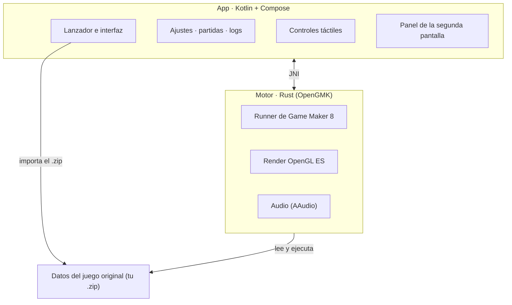

# Pokémon Reloaded en Android · edición AYN Thor (doble pantalla)

[](LICENSE)
[](https://github.com/just-a-simple-dot/pokemon-reloaded-ayn-thor/releases)
[](https://github.com/just-a-simple-dot/pokemon-reloaded-ayn-thor/releases)

Ejecuta **Pokémon Reloaded** en Android sin emulador de Windows de por medio.

Este repo es un fork de [Pokémon Reloaded en Android](https://github.com/Klisee/pokemon-reloaded-android),
de [@Klisee](https://github.com/Klisee), adaptado a consolas de **doble pantalla** como la **AYN Thor**:
el juego va arriba y la pantalla de abajo se convierte en un panel de accesos directos. En un móvil de
una sola pantalla funciona igual que la app original.

## Lo nuevo de esta edición

- **Panel en la segunda pantalla.** Botones táctiles que pulsan teclas del juego (movimientos, menú,
  objetos, Pokéball, ataques…), más la **hora** y el **porcentaje de batería**. La ventana del panel
  nunca se queda con el foco, así que los controles físicos de la consola siguen llegando al juego
  aunque toques abajo.
- **Un panel fuera de combate y otro en combate.** El juego avisa al empezar y al terminar cada
  combate, y el panel cambia solo.
- **Panel editable**, en Ajustes → Pantalla inferior: nombre, tecla y orden de cada botón, añadir o
  borrar botones, y el título y las columnas (2 a 5) de cada sección, para cada uno de los dos paneles.
- **Mando reasignable a cualquier tecla**, en Ajustes → Mando: cada botón (A, B, X, Y, LB, RB, LT, RT,
  los dos sticks al pulsarlos, Start y Select) puede pulsar cualquier tecla del teclado (letras,
  números, F1–F12, flechas, Shift/Ctrl/Alt, símbolos, teclado numérico) o quedarse sin asignar.
- **Se instala junto a la app original**: se llama *Pokemon Reloaded Thor* (`com.klisee.reloaded.thor`),
  así que no la sustituye. Tendrás que importar el juego en ella y pasar tu partida desde Ajustes → Partidas.

### Mando por defecto

| Mando (Xbox) | Tecla | | Mando (Xbox) | Tecla |
|---|---|---|---|---|
| X | Z (interactuar) | | LB | Ctrl (modificadores) |
| A | X (cancelar / correr) | | LT | Shift izq. (ataques) |
| B | C | | RB | B (Pokéball) |
| Y | V | | RT | O (objetos) |
| Select | Enter (menú) | | Pulsar stick izq. | P (prob. captura) |
| Start | Espacio (Pokémon) | | Pulsar stick der. | Espacio (Pokémon) |

### Paneles por defecto

**Fuera de combate:** *Movimientos* (1 Corte, 2 Vuelo, 3 Surf, 4 Fuerza, 5 Destello, 6 Golpe roca,
7 Buceo, 8 Menú habilidades) y *Accesos* (B Sacar Pokémon, Enter Menú, O Objetos, V Bicicleta, M Mapa,
Espacio Ver Pokémon, C Caña de pescar).

**En combate:** *Pokémon* (1–6 Poke 1–6, Espacio Ver todos, S Siguiente) y *Accesos* (B Pokéball,
Shift izq. Ataques, A Objeto asignado, P Prob. captura, Ctrl Modificadores, O Objetos, E Escapar combate,
M Mega evolución, F Flauta).

## Qué es esto, en realidad

Lo de "port" es un decir, y conviene aclararlo. Pokémon Reloaded es un juego hecho en Game Maker 8
para Windows, y aquí **no se ha reescrito ni recompilado nada**. Lo que hace esta app es
**ejecutar el juego original tal cual**, con sus archivos intactos, sobre
[OpenGMK](https://github.com/OpenGMK/OpenGMK): una reimplementación nativa en Rust del motor de
Game Maker 8.

Dicho de otro modo: no hay Wine, no hay Windows emulado, no hay capa de traducción. El motor está
escrito para Android y compilado para el móvil, así que el juego corre prácticamente como un nativo.
Lo único que se ha "porteado" son las tripas del motor, no el juego.

La app sí aporta todo lo de fuera del juego: importar el juego desde un `.zip`, controles táctiles,
ajustes, gestión de partidas y logs. El juego en sí no se toca.

## Cómo funciona

- **Importar.** Le das a Importar y eliges el `.zip` del juego. La app lo descomprime en su propio
  almacenamiento privado, así que no depende de permisos de almacenamiento ni de dónde lo tengas
  guardado.
- **Ejecutar.** El motor (OpenGMK, en Rust) se carga como librería nativa y arranca el runner de
  Game Maker 8 sobre los datos del juego. El render va por OpenGL ES y el audio por AAudio.
- **Controles.** La capa táctil no es fija: cambia según el estado del juego, así que en el mapa
  tienes una cruceta y en los menús otra cosa. Cada botón pulsa una tecla del juego. También funciona
  un mando real, detectado solo, y desde Ajustes → Mando eliges qué tecla pulsa cada botón.
- **Segunda pantalla.** Si el dispositivo tiene otra pantalla, la app abre en ella el panel de
  accesos directos con la hora y la batería, y lo cambia entre exploración y combate.
- **Partidas.** Se leen y escriben en la carpeta del juego. Desde Ajustes → Partidas puedes verlas,
  exportarlas, importarlas, borrarlas y mover una de una ranura a otra. Si jugabas en PC, tu partida
  entra por aquí.
- **Frames.** En Ajustes → Frames, **30 FPS (Original)** es el modo por defecto. **60 FPS
  (Experimental)** y **120 FPS (Experimental)** interpolan movimiento y cámara a esa tasa; la opción
  de 120 solo se habilita si el panel anuncia 120 Hz o más. **FPS sin Límite** dibuja todo lo que
  pueda el móvil y también requiere 120 Hz o más. La simulación sigue a 30 pasos/s: no va más rápido
  el juego, y las animaciones de sprites y la lógica siguen a 30 Hz. Los modos experimentales gastan
  más batería y pueden fallar. En escritorio se elige con `-R auto`, `-R 60`, `-R 120` o
  `-R uncapped`, y `OPENGMK_RENDER_LOG=1` imprime los dibujos/s y los pasos/s reales.
- **Salir y volver.** Al mandar la app a segundo plano, el bucle se detiene y el audio se corta de
  verdad; al volver, sigue donde estaba en vez de quedarse en negro.
- **Logs.** Si algo va mal, la app escribe un log y lo puedes compartir como archivo de texto desde
  Ajustes → Logs, sin perderlo al reiniciar el móvil.

## Cómo está montado



La app y el motor son dos mundos separados que hablan por JNI. El motor no sabe de Android ni de
interfaz: solo sabe ejecutar el juego. La app no sabe de Game Maker: solo lo lanza y lo envuelve.
Esa separación es la que permite tocar la interfaz sin romper el motor, y viceversa.

## Qué necesitas

Los archivos originales del juego, que están en el blog de **F3R**:
[pokemon-reloaded.blogspot.com](https://pokemon-reloaded.blogspot.com/)

El repo no incluye ningún asset del juego, y eso es justo lo que lo mantiene limpio.

## Cómo se usa

1. Instala el APK `arm64-v8a` de la [última release](https://github.com/just-a-simple-dot/pokemon-reloaded-ayn-thor/releases)
   (es la arquitectura de la AYN Thor y de casi cualquier móvil actual).
2. Consigue el juego en un `.zip` y dale a **Importar** (o usa **Descargar** para abrir el blog).
3. **Jugar**. Si ya tenías partida en el PC, tráela desde Ajustes → Partidas.

## Estado

Está en beta y se nota: puede petar. Si algo falla, guarda un log desde Ajustes → Logs y ábrelo como
issue.

Ya resuelto:

- **La pantalla negra en móviles con GPU PowerVR** (MediaTek Helio y similares). El motor enlazaba el
  VAO/VBO/programa una sola vez y daba por anulado el búfer tras cada dibujo: en GPUs diferidas
  (TBDR) eso dejaba al procesador de vértices leyendo memoria descartada y no se pintaba nada. Ahora
  se enlazan en cada dibujo, no se invalida el búfer, el bloque de uniforms `std140` tiene los
  offsets correctos y los atlases se suben por lotes — con esto último el arranque pasó de ~85 s a
  un momento. Gracias a **Alexpix0 (Armando)**, que lo encontró y probó. (Los detalles del
  diagnóstico están en el historial de commits.)
- **El escalado en combate**, que se quedaba con la cámara descolocada.
- **El movimiento Vuelo**, que no llegaba a conectar.
- **La XP infinita** al abrir la mochila tras debilitar a un Pokémon.
- **El cierre en combates dobles** al cambiar de Pokémon.

Lo que ahora mismo da problemas, y resolveré después:

- **El audio se corta** en algunos móviles al mezclar música y efectos.

Y por ir haciendo, sin orden:

- Poner imágenes propias (pixel art) a más botones táctiles.
- Más ajustes de rendimiento en móviles modestos.
- Revisar la compatibilidad con mandos de todo tipo.

## Compilar

Cada arquitectura lleva su propio APK (el motor es nativo). `arm64-v8a` es la de por defecto:

```
# El motor (Rust) y su .so para Android
cd src/OpenGMK
cargo ndk -t arm64-v8a --platform 29 build -p gm8emulator --release
cargo ndk -t armeabi-v7a --platform 29 build -p gm8emulator --release
cargo ndk -t x86_64 --platform 29 build -p gm8emulator --release

# La app: un APK por arquitectura
cd ../../android
./build.sh :app:assembleRelease
./build.sh :app:assembleRelease -PtargetAbi=armeabi-v7a
./build.sh :app:assembleRelease -PtargetAbi=x86_64
./build.sh :app:assembleRelease -PtargetAbi=universal
```

La **universal** lleva las tres arquitecturas y sirve de comodín, a costa de pesar unos 10 MB más.

Se puede compilar tanto en Linux como en Windows (en Windows hace falta Visual Studio Build Tools con
C++ para los scripts de compilación de Rust).

El workflow `.github/workflows/build-apks.yml` compila todas en CI al publicar un tag `v*` y las sube a
una Release de GitHub. Para que todas las versiones se firmen igual (y se actualicen encima de la
anterior sin desinstalar), guarda tu clave en los secrets del repo: `THOR_KEYSTORE_B64` (el `.p12` en
base64) y `THOR_KEYSTORE_PASSWORD`. Sin ellos se firma con una clave debug distinta en cada ejecución.

## Licencia

Copyright (C) 2026 Klisee y colaboradores.

Este proyecto se distribuye bajo la **GNU General Public License v2.0** (`GPL-2.0-only`), la misma
licencia que OpenGMK, del que toma el motor. El texto completo está en [LICENSE](LICENSE).

Los archivos originales de Pokémon Reloaded no forman parte de este repositorio ni se distribuyen
con el APK; son obra de F3R Productions y se rigen por sus propios términos. `vendor/udon` también
es GPL-2.0-only, y `vendor/ramen` se distribuye bajo licencia Zlib.

## Créditos

- **[Klisee](https://github.com/Klisee)**: por [Pokémon Reloaded en Android](https://github.com/Klisee/pokemon-reloaded-android), la app sobre la que está hecha esta edición.
- **Pokémon Reloaded** es obra de **F3R Productions**: [el blog del juego](https://pokemon-reloaded.blogspot.com/)
- **OpenGMK**, la reimplementación del motor sin la que esto no existiría: [github.com/OpenGMK/OpenGMK](https://github.com/OpenGMK/OpenGMK)
- **LixarXDX**: por el rediseño de los controles táctiles y los controles clásicos, la base de la personalización de esta versión.
- **[Kizzy (dead8309)](https://github.com/dead8309/KizzyRPC)**: por KizzyRPC, el método en el que se basa el Rich Presence con token de usuario.
- **[nyxthor-dev](https://github.com/nyxthor-dev)**: por el análisis del congelamiento al volver del segundo plano y las propuestas de corrección ([issue #77](https://github.com/Klisee/pokemon-reloaded-android/issues/77)).
- **Alexpix0 (Armando)**: por el arreglo del renderizado que resolvió la **pantalla negra en móviles con GPU PowerVR** (enlazar VAO/VBO/programa en cada dibujo, quitar la invalidación del búfer que rompía en GPUs diferidas, corregir el `std140` del bloque de uniforms y subir los atlases por lotes, que además dejó el arranque muchísimo más rápido). [Su PR](https://github.com/Klisee/pokemon-reloaded-android/pull/2)
- **Google Sans Flex**, la tipografía de la app

Pokémon es una marca de Nintendo, Game Freak y Creatures. Este proyecto no está afiliado ni
respaldado por ellos.
